# Infrastructure as Code with Terraform on Azure

Building a network by clicking through the Azure portal works once. It leaves no record of what you built, and nobody can rebuild it exactly the same way. Infrastructure as Code means you write down what you want in a text file and let a tool build it. This lab uses Terraform to deploy a resource group, a virtual network and a subnet. Then it adds a network security group to the running environment, and tears everything down with one command.

The business reason is simple. A file can be reviewed, stored in Git and run again to get the same result every time. That means fewer manual mistakes, and a fast, complete cleanup that stops the bill.

You do not need any Terraform experience to follow this. Each step says what it does, what to do, and what you should see when it works. This lab runs on your own computer with the Azure CLI and Terraform. It does not use Azure Cloud Shell.

## What this lab is for

- **Describe, don't click:** write a configuration file that says what you want in Azure.
- **Run the Terraform workflow:** `init`, `plan` and `apply`, always in that order.
- **See what Terraform remembers:** find the state file and learn why it matters.
- **Change a live environment safely:** add a resource and watch Terraform touch only the new piece.
- **Clean up completely:** destroy everything with one command and prove nothing is left.

## Words you will see

| Word | What it means here |
|---|---|
| IaC (Infrastructure as Code) | Describing infrastructure in files, so a tool can build it and rebuild it. |
| Terraform | A tool that reads those files and builds the infrastructure for you. |
| Declarative | You write what you want, not the steps to get there. Terraform works out the steps. |
| Provider | A plugin that knows how to talk to one platform. The Azure provider is called `azurerm`. |
| Resource | One thing Terraform manages, such as a resource group or a subnet. |
| State file | `terraform.tfstate`, Terraform's record of what it has built. It compares your files with this record to decide what to change. |
| Dependency | When one resource uses another's name, Terraform builds them in the right order. |
| Resource group | A container in Azure that holds related resources. |
| Virtual network (VNet) | A private network inside Azure. |
| Subnet | A slice of a virtual network with its own range of addresses. |
| CIDR (Classless Inter-Domain Routing) range | A short way to write a block of addresses. `10.0.1.0/24` is the 256 addresses from `10.0.1.0` to `10.0.1.255`. |
| Network security group (NSG) | A set of allow and deny rules for network traffic. |

## How Terraform works

Terraform describes what you want and not how to get it. You write "I want a resource group with this name in this region", and Terraform works out the steps.

Terraform keeps a state file. After it builds something it writes `terraform.tfstate` into your project folder. Every time you run `plan` or `apply` it reads that file to know what already exists, so it changes only what is different. Do not delete it, move it, or edit it by hand.

Four commands do all the work:

| Command | What it does | When to run it |
|---|---|---|
| `terraform init` | Downloads the Azure provider plugin | Once per project, first |
| `terraform plan` | Shows what would change and changes nothing | Before every apply |
| `terraform apply` | Makes the changes in Azure | After you have read the plan |
| `terraform destroy` | Removes everything in the state file | When you tear the lab down |

## Architecture

```
  Resource group: rg-lab04-tf-<yourname>   (Central US)
+--------------------------------------------------------+
|                                                        |
|  Virtual network: vnet-terraform  (10.0.0.0/16)        |
|  +--------------------------------------------------+  |
|  |  Subnet: snet-backend  (10.0.1.0/24)             |  |
|  +--------------------------------------------------+  |
|                                                        |
|  Added in Step 9:                                      |
|  Network security group: nsg-web  (no rules yet)       |
|                                                        |
+--------------------------------------------------------+
```

## Lab variables

| Item | Value |
|---|---|
| Resource group | `rg-lab04-tf-<yourname>` |
| Virtual network | `vnet-terraform`, address space `10.0.0.0/16` |
| Subnet | `snet-backend`, `10.0.1.0/24` |
| Network security group (Step 9) | `nsg-web` |
| Azure provider | `hashicorp/azurerm`, version `~> 3.0` (any 3.x) |
| Region | Central US. Any region works. |

## What's inside

```
Infrastructure-as-Code-with-Terraform/
  README.md             this file
  main.tf               the Terraform configuration
  .terraform.lock.hcl   pins the provider version (created by terraform init)
  .gitignore            keeps state files and keys out of Git
  images/               screenshots from the lab, with IDs blacked out
```

The state files (`terraform.tfstate` and `terraform.tfstate.backup`) and the `.terraform` folder appear in your folder when you run the lab, but they are not part of this repository.

## Before you start

- An Azure subscription and permission to create resources in it.
- The Azure CLI installed.
- Terraform installed. This lab was run with version 1.16.2.
- Visual Studio Code, with the `code` command available in your terminal.

Sign in first, and do it again in any new terminal:

```powershell
az login
```

## Use your own name, not mine

Wherever you see `<yourname>`, replace it with your own name or a short handle, and leave out the angle brackets. If you type `<yourname>` into a terminal as it is, PowerShell reads the `<` as a file redirect and fails. Terraform reads the name from `main.tf`, so you change it there once in Step 3. The screenshots in this repository show my name in the resource group, `rg-lab04-tf-demarcus`. Use lowercase letters, with no spaces.

Never commit the state file. `terraform.tfstate` holds details of your real resources. The `.gitignore` in this repository blocks it.

## Step 1: Check your tools

**What this step does.** It confirms you are signed in to the right subscription and that Terraform is installed.

**What to do.** Run:

```powershell
az account show --query name -o tsv
```

```powershell
terraform version
```

**What you should see.** The first prints the name of your subscription. The second prints the Terraform version and, if there is one, a note about a newer release. Mine printed `Terraform v1.16.2` and a note that 1.17.2 was available. The older version worked fine for this whole lab, so there is no need to update first.

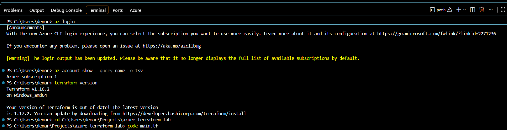

## Step 2: Create the project folder

**What this step does.** It makes one folder to hold every Terraform file for this lab.

**What to do.** Run:

```powershell
mkdir azure-terraform-lab
cd azure-terraform-lab
```

**What you should see.** Your prompt now ends with `azure-terraform-lab>`. Run this from the folder where you keep your projects. I used a `Projects` folder inside my user folder.

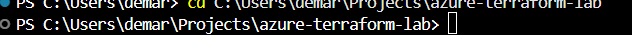

## Step 3: Write the configuration

**What this step does.** It describes the three resources you want. Nothing is built yet.

**What to do.** Open a new file in Visual Studio Code:

```powershell
code main.tf
```

Paste this into the editor, not into the terminal:

```hcl
# Use the Azure provider, any 3.x version.
terraform {
  required_providers {
    azurerm = {
      source  = "hashicorp/azurerm"
      version = "~> 3.0"
    }
  }
}

# The provider needs a features block, even when it is empty.
provider "azurerm" {
  features {}
}

# 1. Resource group. Change demarcus to your own name.
resource "azurerm_resource_group" "rg" {
  name     = "rg-lab04-tf-demarcus"
  location = "Central US"
}

# 2. Virtual network. It reads the group's name and location, so Terraform
#    knows to build the group first.
resource "azurerm_virtual_network" "vnet" {
  name                = "vnet-terraform"
  location            = azurerm_resource_group.rg.location
  resource_group_name = azurerm_resource_group.rg.name
  address_space       = ["10.0.0.0/16"]
}

# 3. Subnet. 10.0.1.0/24 is a slice of the network's 10.0.0.0/16 range.
resource "azurerm_subnet" "subnet" {
  name                 = "snet-backend"
  resource_group_name  = azurerm_resource_group.rg.name
  virtual_network_name = azurerm_virtual_network.vnet.name
  address_prefixes     = ["10.0.1.0/24"]
}
```

Change `demarcus` in the resource group name to your own name, then save the file with `Ctrl + S`.

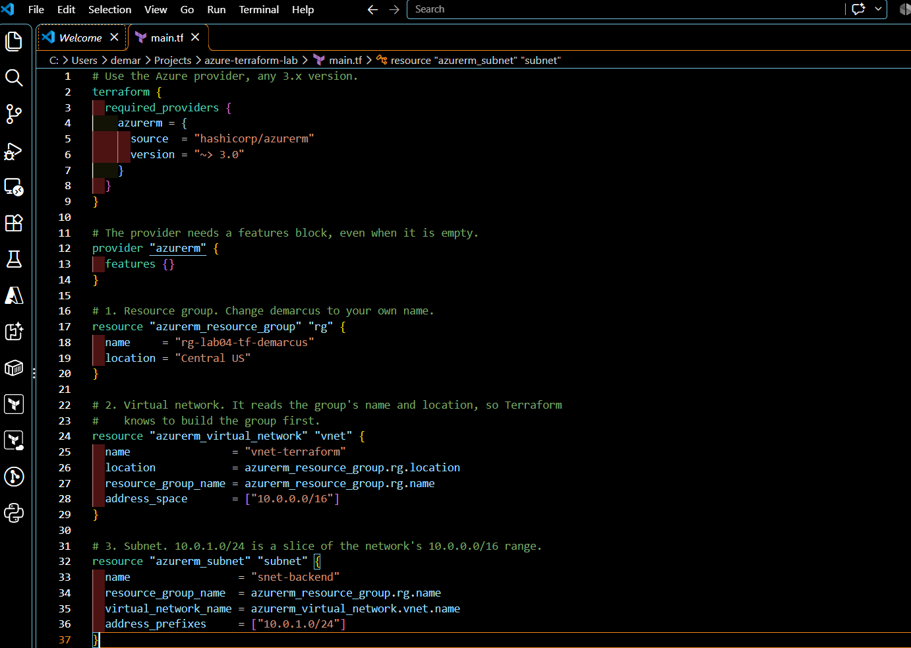

**What you should see.** Print the file and confirm that your name is in the resource group name:

```powershell
Get-Content main.tf
```

## Step 4: Initialize

**What this step does.** It downloads the Azure provider plugin. You run it once per project.

**What to do.** Run:

```powershell
terraform init
```

**What you should see.** The output ends with `Terraform has been successfully initialized!`. Two new things now exist in the folder: a hidden `.terraform` folder that holds the plugin, and a file named `.terraform.lock.hcl` that pins the exact provider version. List them:

```powershell
dir -Force
```

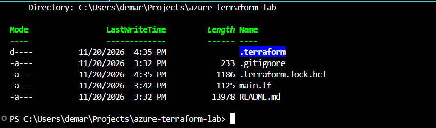

There is no `terraform.tfstate` yet. `terraform init` does not create one. Only `terraform apply` does.

## Step 5: Check the file

**What this step does.** It catches typing mistakes before Terraform talks to Azure.

**What to do.** Run these two commands one at a time:

```powershell
terraform fmt
```

```powershell
terraform validate
```

**What you should see.** `terraform fmt` prints nothing if the file is already tidy, or the name of a file it fixed. `terraform validate` prints `Success! The configuration is valid.` Validate checks the file's syntax and structure and does not ask Azure anything. It will not catch a name that is already taken or a quota limit. Those only show up at plan or apply.

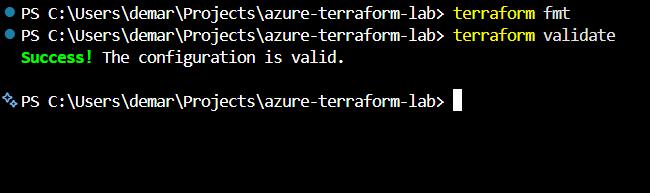

## Step 6: Plan

**What this step does.** It compares your file with what exists in Azure and shows what it would do. It changes nothing.

**What to do.** Run:

```powershell
terraform plan
```

**What you should see.** The last line says `Plan: 3 to add, 0 to change, 0 to destroy.` The three are the resource group, the virtual network and the subnet. Never skip the plan. With three resources it is short, but with dozens it is what stops you from changing or destroying something by accident.

Two things in the plan are normal. The region prints as `centralus`, which is the form Azure uses internally for Central US. And at the bottom Terraform notes that you did not use the `-out` option, so it cannot promise that a later apply does exactly what this plan showed. You can ignore that note in this lab.

## Step 7: Apply

**What this step does.** It builds the resources in Azure.

**What to do.** Run:

```powershell
terraform apply
```

Terraform shows the plan again and asks for confirmation. Type the whole word `yes` and press Enter. A single `y` does not work. That is on purpose, so nobody confirms a change by accident.

**What you should see.** Each resource shows `Creating...` and then `Creation complete`. The resource group comes first, then the virtual network, then the subnet. Terraform works out that order from the names each resource uses. The output ends with `Apply complete! Resources: 3 added, 0 changed, 0 destroyed.` A new file, `terraform.tfstate`, now sits in the folder. That is Terraform's record of what it built.

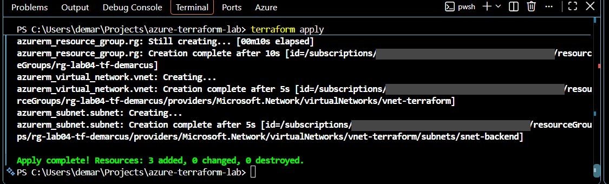

Mine was about 4 KB. It holds the real IDs of your resources, including your subscription ID, so never commit it or paste its contents anywhere public. The apply output above shows those IDs too, which is why the screenshot has them blacked out.

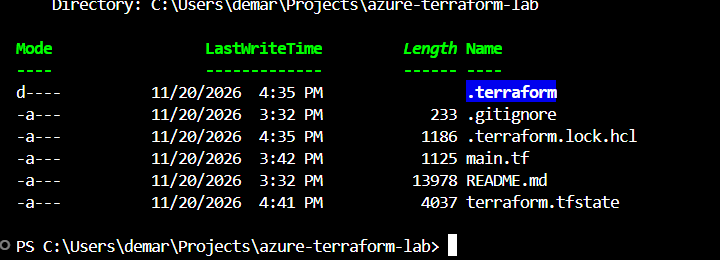

## Step 8: Check it in Azure

**What this step does.** It confirms what Terraform says it built is really there. Check Azure and not only Terraform's output.

**What to do.** Run:

```powershell
az group exists -n rg-lab04-tf-<yourname>
```

```powershell
az network vnet subnet list -g rg-lab04-tf-<yourname> --vnet-name vnet-terraform -o table
```

Then open the portal, go to **Resource groups**, open `rg-lab04-tf-<yourname>`, and open `vnet-terraform`. Click **Subnets**.

**What you should see.** The first prints `true`. The second lists one subnet, `snet-backend`, with the range `10.0.1.0/24` and a provisioning state of `Succeeded`.

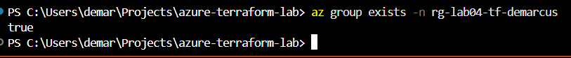

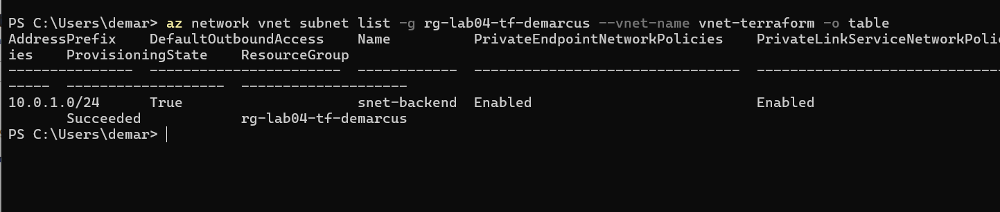

In the portal, the resource group lists **one** resource, `vnet-terraform`, even though Terraform built three. The subnet does not get its own row because it lives inside the virtual network. You find it on the network's **Subnets** page.

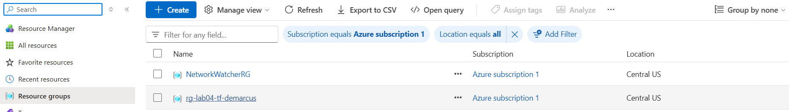

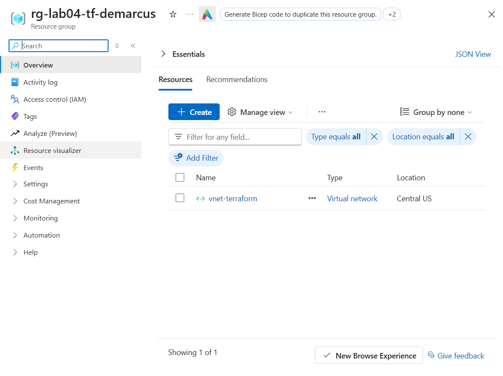

The Subnets page shows `snet-backend`, `10.0.1.0/24` and 251 available IPs. A `/24` holds 256 addresses, and Azure reserves 5 in every subnet.

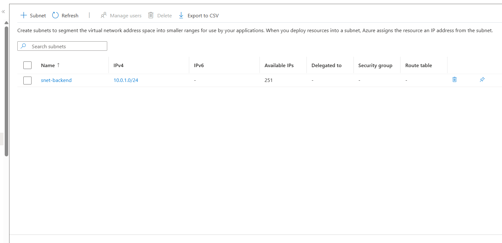

## Step 9: Add a resource to the live environment

**What this step does.** It shows the most useful thing about Terraform. When you add a resource to the file, Terraform builds only the new piece and leaves everything else alone.

**What to do.** Open `main.tf` again, scroll to the very bottom, and add this block after the subnet block. Do not change anything above it:

```hcl
# 4. Network security group. It starts with no rules of your own.
resource "azurerm_network_security_group" "nsg" {
  name                = "nsg-web"
  location            = azurerm_resource_group.rg.location
  resource_group_name = azurerm_resource_group.rg.name
}
```

Your editor may show faint grey suggested text under the block, such as a comment and a resource that attaches the subnet to the network security group. That is a suggestion, not part of your file. Press `Esc` and do not press `Tab`. Accepting it would add a fifth resource and change what this lab shows.

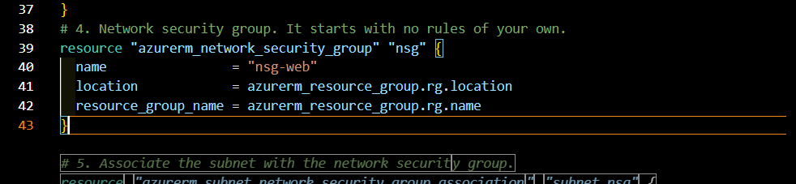

Save the file, then run:

```powershell
terraform plan
```

**What you should see.** The plan says `Plan: 1 to add, 0 to change, 0 to destroy.` Terraform compared the file with its state file, saw that the first three resources already exist and have not changed, and found that only the network security group is new. The `Refreshing state` lines above the plan are Terraform checking its records against Azure before it compares. They contain your subscription ID, so crop them out if you share a screenshot. Now apply it, and type `yes`:

```powershell
terraform apply
```

The output ends with `Apply complete! Resources: 1 added, 0 changed, 0 destroyed.` Nothing that already existed was rebuilt.

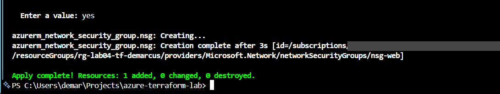

Check it from Azure:

```powershell
az network nsg list -g rg-lab04-tf-<yourname> -o table
```

`nsg-web` is listed, in the state `Succeeded`.

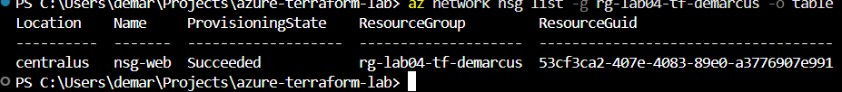

In the portal, the resource group now lists two resources, `nsg-web` and `vnet-terraform`. The subnet is still inside the network and not listed on its own.

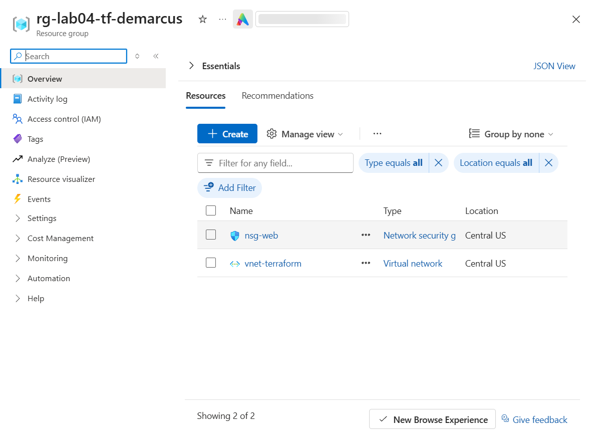

The group exists, but it is not attached to the subnet. On the Subnets page, the Security group column for `snet-backend` still shows a dash. If you open the subnet's Edit panel, Network security group is set to None, with `nsg-web` available as a choice.

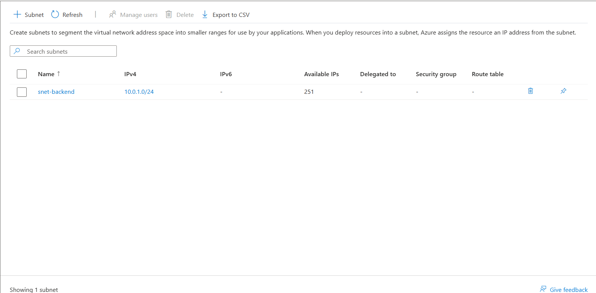

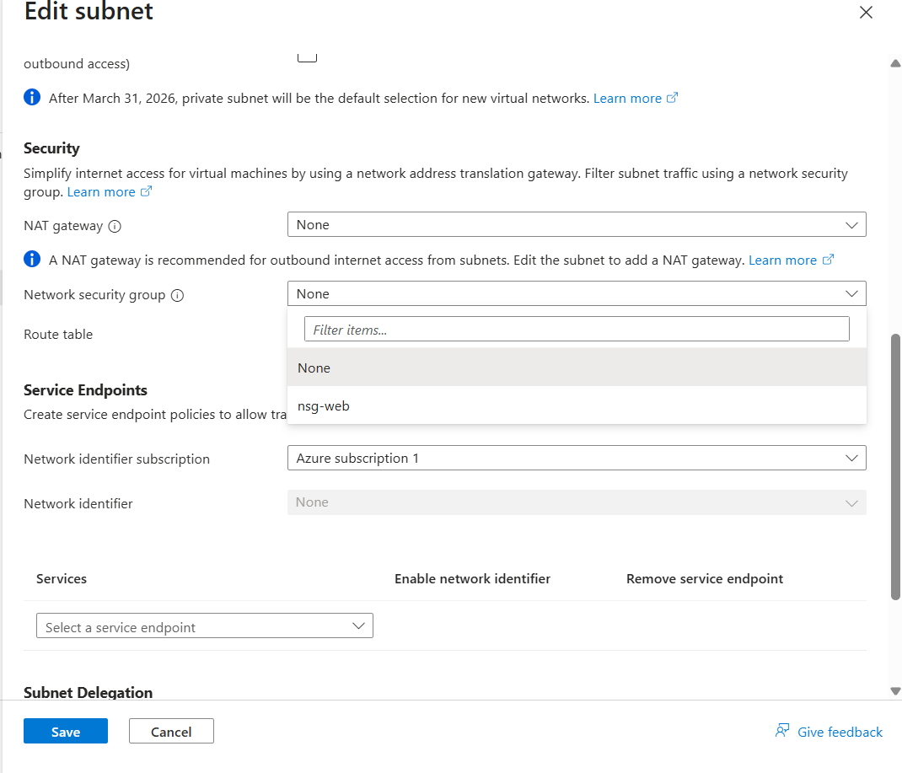

Close the panel with **Cancel**. Do not attach it here. That would change Azure by hand, outside Terraform. A network security group that is not attached to anything does not filter any traffic yet.

## Step 10: Tear it down

**What this step does.** It removes everything Terraform built, in the right order, and keeps the state file in step with Azure.

**What to do.** Run:

```powershell
terraform destroy
```

**What you should see.** Terraform lists everything it will remove. The last line of the plan says `Plan: 0 to add, 0 to change, 4 to destroy.`

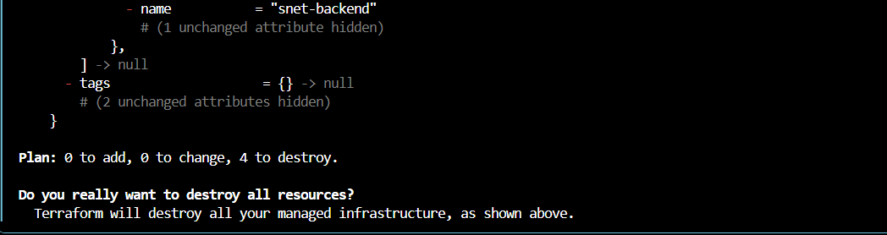

Type `yes`. Terraform removes things in the reverse of the order it built them, so anything that depends on something else goes first. The network security group and the virtual network went before the resource group, which went last and took about 16 seconds. It ends with `Destroy complete! Resources: 4 destroyed.` Then check from Azure:

```powershell
az group exists -n rg-lab04-tf-<yourname>
```

It prints `false`.

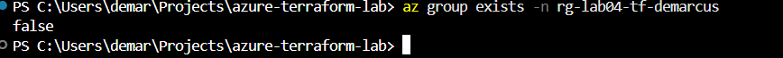

Look at the folder once more. `terraform.tfstate` is still there, but in my run it dropped from 4037 bytes to 182, which fits a file that no longer lists any resources. A new file, `terraform.tfstate.backup`, holds Terraform's copy of the state from just before the destroy. It contains your real resource IDs, and `.gitignore` blocks it too.

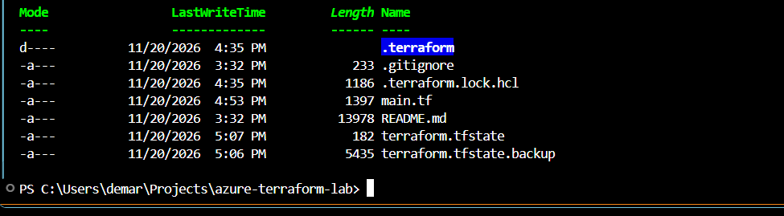

Use `terraform destroy` and not the portal to delete what Terraform built. If you delete the resource group in the portal, the state file still records that the resources exist, and the next `terraform plan` gets confused.

## Troubleshooting

| Problem | What to check |
|---|---|
| `terraform` is not recognized | Terraform is not installed, or the terminal was opened before it was. Close the terminal, open a new one and try again. |
| Terraform cannot sign in to Azure | Run `az login`, then try again. |
| The resource group already exists | A group with that name is already in your subscription. Change the name in `main.tf` to something unique. |
| Syntax error on line X | Open `main.tf`, go to that line, and look for a missing `}` or a missing quote. Every `{` needs a matching `}`. |
| `terraform plan` says `0 to add` | Terraform already built these resources and the state file knows it. To start again, run `terraform destroy` first. |
| Grey text appears under your code in the editor | It is a suggestion, not part of the file. Press `Esc`. Do not press `Tab`, because that accepts it. |
| The portal shows fewer resources than Terraform created | The portal lists a subnet inside its virtual network, not as a separate row in the resource group. Open the network and click **Subnets**. |
| `terraform apply` fails partway through | The cause may be a temporary Azure error or a quota limit. Run `terraform apply` again. Terraform skips what already exists and retries only what failed. |

## What this lab teaches

- **The file is the record.** Three resources, and later a fourth, are described in one `main.tf`. Anyone can read it, store it in Git and run it again to get the same result.
- **Plan before you apply.** `terraform plan` shows what would change and changes nothing. The second plan said 1 to add, 0 to change, 0 to destroy, and that is how you know an edit will not touch what already exists.
- **Terraform works out the order.** The virtual network reads the resource group's name, and the subnet reads the network's name. That is how Terraform knows to build the group first, and to remove it last.
- **Terraform changes only what changed.** Adding `nsg-web` built one resource. The group, the network and the subnet were checked and left alone.
- **The state file is Terraform's memory, and it is sensitive.** It holds your real resource IDs, including the subscription ID, so it is never committed. This lab keeps state on your own computer. For a team, or for anything you cannot afford to lose, state belongs in a remote backend.
- **Check Azure, not only Terraform.** The CLI and the portal both confirmed each step. They also showed that the portal lists a subnet inside its virtual network, so the resource count there is lower than the number of resources Terraform manages.
- **Created is not the same as attached.** `nsg-web` exists but is not attached to the subnet, so it filters nothing. Attaching it would be a separate resource in the file.
- **Destroy cleans up completely.** One command removed all four resources in the right order, and `az group exists` returned `false`. Use `terraform destroy` for what Terraform built, so its state file stays in step with Azure.
